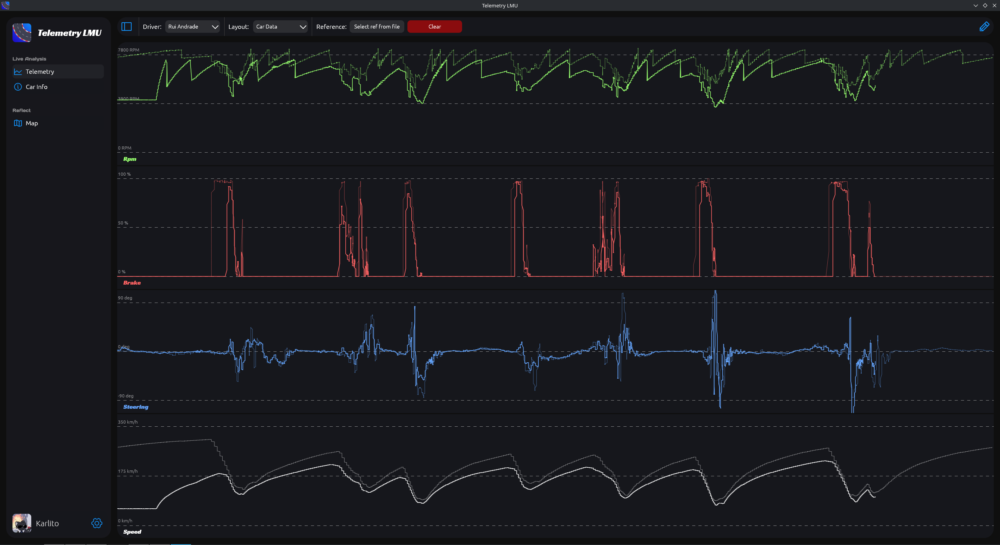

  

<h1 align="center">Telemetry LMU</h1>

  <strong>The ultimate telemetry visualization
tool for Le Mans Ultimate.</strong>

## Demo

https://youtu.be/aW0ga2AiyTQ

## Quick Start

### Windows

1. Navigate to the [Releases](https://github.com/Karlito05/TelemetryLMU/releases).
2. Download and run the latest `.exe` installer.

### Linux

1. **Prerequisite:** Install [SIMple Bridge](https://github.com/Karlito05/SIMple-Bridge)
2. Download the Arch Linux or Debian package from our [Releases](https://github.com/Karlito05/TelemetryLMU/releases).

## Features

### Telemetry Page

- **Customizable Layout**
- **Multiple Graph Types**
- **Customizable Graphs**

### Car Info Page

- **Detailed info**
- **Automatic detection**

### Map Page

- **See where you drove**
- **Detailed delta and inputs**
- **Learn faster**

## Building

### Prerequisites

- Rust **Nightly**
- Docker (Optional - for packaging)

### How to build

1. Clone this repository with `git clone https://github.com/Karlito05/TelemetryLMU.git`
2. Change directory to be in the root of the project with `cd ./TelemetryLMU`
3. Build with `cargo build` or directly run with `cargo run`

4. Optionally you can make packages via running the `package_all.sh` in the root of the project.

## How it works

This app is made fully in rust! On the frontend side of things I am using [egui](https://github.com/emilk/egui) but almost all of the elements seen are custom made via the painter functionality.

On the backend side of things stuff gets more interesting. A thread (separate to the UI) is running a "telemetry provider" manages all of the needed telemetry data. This means that the UI doesn't have to refresh when the app is minimized or when pages that don't need to update constantly (like the map page) are open. The logger is also very light weight on the CPU. It takes up a lot of RAM (around 200Mb) due to the amounts of data it is working with. However doing it this way ensures a smoother experience for the user!

## Credits

- This project relies heavily on the [egui](https://github.com/emilk/egui) library.
- Thanks to [Thrillonek](https://github.com/Thrillonek) for helping with the UI design.

[!NOTE]
> A note for the Stardance reviewers
> Guys. I really do understand that you are so paranoid about the readmes being AI for whatever reason, but please READ IT before you judge if its AI. Just because this readme had emojis which I PUT IN THERE by HAND for the readme to look better and not be all black and white doesn't mean it is AI. If you really think that someone can work on a project for 200h (mostly without AI) and then be so lazy to not even write a readme, then you should reconsider how you look at people :). The emojis have since been removed as per the 1st "Readme is AI" return. I have discussed this on slack with other Stardance competitors and after they read the readme it didn't look AI to them. So I don't really know (if you are reading the readme) where this "Your readme is AI" is comming from. I would rewrite the readme but that would be just a worse version of it because this is the best my English can do (English is not my first language), so I am not going to. However I have changed a few things because looking back at it it had a bit too much "marketing speech" in it. And you know it's getting very silly. I have been woerking on this project for more than 3 months and now I am waiting more than a month getting my readme project rejected for technicalities which aren't even my fault or don't matter. Thank you for your time and understanding and have a nice day :).
